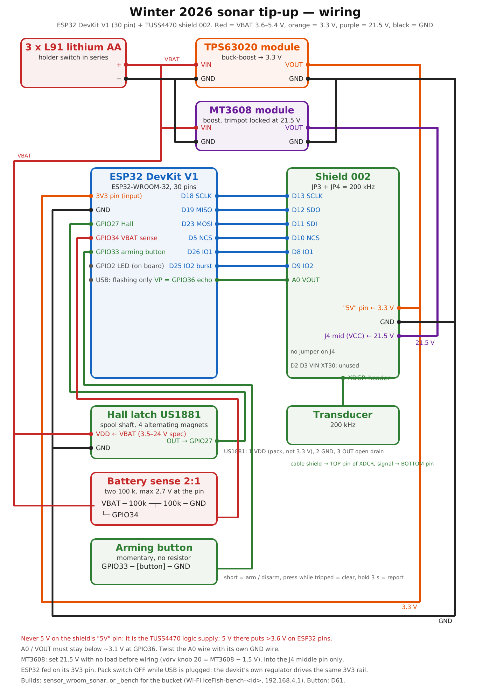
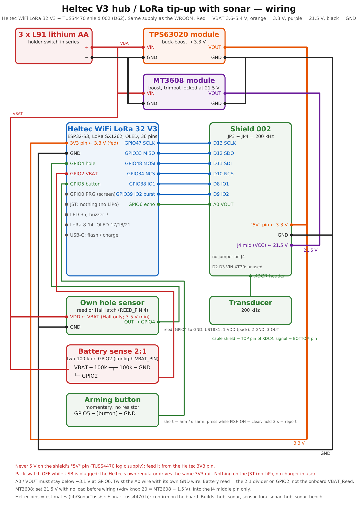

# Ice fishing tip-up mesh with per-hole sonar

Firmware for a network of ice-fishing tip-ups (brimbales) around a chalet: each hole reports a bite over
ESP-NOW to a hub on the ice, hubs talk LoRa (TDMA mesh, SF9/500 kHz) to the chalet box, and the chalet shows
everything on its OLED and on a phone web page over its own hotspot. Holes fitted with a sonar (TUSS4470 +
200 kHz transducer) stream depth, bottom type and fish to the chalet.

## Origin and credits

The sonar side of this project started from **open_echo** by Jan Neumann: the TUSS4470 shield 002 used in the
winter 2026 tip-ups and the register sequence that is known to work in water come from there. Cited as its README asks:

```bibtex
@misc{open_echo,
  author       = {Jan Neumann},
  title        = {open\_echo},
  year         = {2026},
  publisher    = {GitHub},
  journal      = {GitHub Repository},
  howpublished = {\url{https://github.com/Neumi/open_echo}},
  note         = {ORCID: https://orcid.org/0009-0003-9829-8959}
}
```

The firmware here (driver, processing, mesh, web page) is our own; it is not a fork of open_echo.

## Boards

| Board | Role | Firmware |
|---|---|---|
| Heltec WiFi LoRa 32 V3 | Chalet (master, web page, buzzer), hub, relay, LoRa tip-up, see roles below | `src/lora_node/` |
| ESP32 WROOM | Tip-up: Hall latch on the spool, optional sonar shield | `src/sensor_node/` |
| ESP32-C3 Super Mini | Tip-up with a reed switch (older head) | `src/sensor_node/` |

## Roles (what each board does on the network)

| Role | Board | Env / `flash.py` purpose | Talks to | Own hole | Sonar |
|---|---|---|---|---|---|
| Chalet | Heltec V3 | `cabin` / `chalet` | every hub and LoRa tip-up over LoRa (beacon master); the phone over Wi-Fi | no | no (viewer only) |
| Hub | Heltec V3 | `hub` / `hub`, `--sonar`, `--bench` | the WROOM / C3 tip-ups of its pocket over ESP-NOW; the chalet over LoRa | yes (reed / Hall on GPIO 4, button GPIO 5) | optional (shield on its own hole) |
| Relay | Heltec V3 | `relay` / `relay` | repeats LoRa between a far hub and the chalet | no by default (`HAS_LOCAL_SENSOR=false`; set true in devices.ini for a hole) | only with a hole |
| LoRa tip-up | Heltec V3 | `sensor_lora` / `sensor_lora`, `--sonar` | the chalet directly over LoRa; no ESP-NOW, serves no other hole | yes | optional |
| Tip-up | ESP32 WROOM | `sensor_wroom` / `tipup_wroom`, `--sonar`, `--bench` | the nearest hub over ESP-NOW, deep sleep between events | yes (Hall latch GPIO 27, button GPIO 33) | optional |
| Tip-up (v1 head) | ESP32-C3 | `sensor_c3` / `tipup_c3` | the nearest hub over ESP-NOW | yes (reed GPIO 4) | no |

Hub vs LoRa tip-up on the same Heltec: both are one hole with a sonar option and the same wiring; the hub also collects
the pocket of WROOM tip-ups around it and forwards them. A lone hole with no WROOM around it is a LoRa tip-up; a
hole with WROOM tip-ups around it is a hub. Neither sleeps.

## Winter 2026 sonar tip-up: wiring (ESP32 DevKit V1 30-pin + TUSS4470 shield 002, hand-wired)

Build env: `sensor_wroom_sonar` (or `sensor_wroom_sonar_bench` for the bucket test). Pins = `lib/SonarTuss/src/sonar_tuss4470.h` (WROOM block).


Bench build on a phone: join the Wi-Fi **IceFish-bench-<node id>**, open **http://192.168.4.1** (live values, A-scan,
knobs, notes, RAW captures, record and download the test file).

| # | ESP32 DevKit V1 | Shield 002 header | Signal |
|---|---|---|---|
| 1 | **3V3** (TPS63020 3.3 V) | **5V** pin | TUSS4470 VDD. **Never 5 V**: the shield's "5V" pin is the TUSS4470 logic supply; at 5 V its SDO and VOUT would exceed the ESP32's 3.6 V limit and the ESP32's 3.3 V signals would be below its VIH (0.7 x VDD). The shield's "3.3V" pin is not connected to the TUSS4470 |
| 2 | GND | GND | common ground (pack, TPS63020, MT3608, ESP32, shield) |
| 3 | D18 | D13 | SCLK |
| 4 | D19 | D12 | SDO -> MISO |
| 5 | D23 | D11 | MOSI -> SDI |
| 6 | D5 | D10 | NCS |
| 7 | D26 | D8 | IO1 (held high) |
| 8 | D25 | D9 | IO2 (burst) |
| 9 | VP (GPIO36) | A0 | VOUT echo envelope (twist with its own GND wire) |
| 10 | - | **J4 middle pin (VCC)**, no jumper on J4 | MT3608 output + (MT3608 GND to shield GND) |
| - | not wired | D2, D3, RESET, AREF, 3.3V, VIN | OUT_4 / OUT_3 comparators unused (`SONAR_PIN_O4 = -1`) |

Also on the ESP32: Hall latch OUT -> GPIO27 (US1881 VDD from the pack, 3.5 V min, not 3.3 V), battery divider (2:1) -> GPIO34, LED GPIO2, **arming button GPIO33 -> button -> GND**
(D61: short press arm / disarm, press while tripped clears it, hold 3 s = report; no resistor, internal pull-up).
On the Heltec V3 (hub / LoRa tip-up) the arming button is **GPIO5 -> button -> GND** (PRG stays the screen button).

### Heltec V3 + shield 002 (hub, LoRa tip-up, relay with a hole; D62)

Build env: `hub_sonar` / `sensor_lora_sonar` (`hub_sonar_bench` for the bucket test: `BENCH` line on the USB serial
port every 2 s). Same driver, pins = the Heltec block of `lib/SonarTuss/src/sonar_tuss4470.h` (confirmed on the bench
2026-10-18: SPI, VDRV, burst and ADC all answer). The chalet keeps no sonar. See docs/SONAR_DRIVER.md, "Heltec V3 build".



Supply = the WROOM's: 3 x L91 -> TPS63020 3.3 V into the Heltec **3V3 pin** (and the shield "5V" pin), the Hall
latch VDD **from the pack** (US1881: 3.5-24 V, 3.3 V is below its minimum; its open-drain output is fine with the
ESP32 pull-up), MT3608 from the pack for the 21.5 V, 2:1 divider from the pack to **GPIO2** (`config.h` VBAT_PIN; the
onboard VBAT_Read on GPIO1 sees nothing, there is no LiPo on the JST). Pack switch off while USB is plugged: the
Heltec's own regulator drives the same 3V3 rail.

| # | Heltec WiFi LoRa 32 V3 | Shield 002 header | Signal |
|---|---|---|---|
| 1 | **3.3V** pin | **5V** pin | TUSS4470 VDD. **Never 5 V** (same reason as the WROOM table, row 1) |
| 2 | GND | GND | common ground (supply, MT3608, Heltec, shield) |
| 3 | GPIO47 | D13 | SCLK |
| 4 | GPIO33 | D12 | SDO -> MISO |
| 5 | GPIO48 | D11 | MOSI -> SDI |
| 6 | GPIO34 | D10 | NCS |
| 7 | GPIO38 | D8 | IO1 (held high) |
| 8 | GPIO39 | D9 | IO2 (burst) |
| 9 | GPIO6 (ADC1_CH5) | A0 | VOUT echo envelope (twist with its own GND wire) |
| 10 | - | **J4 middle pin (VCC)**, no jumper on J4 | MT3608 output + at 21.5 V (MT3608 GND to shield GND); MT3608 input from the 3 x L91 pack, as on the WROOM |
| - | not wired | D2, D3, RESET, AREF, 3.3V, VIN | OUT_4 / OUT_3 unused (`SONAR_PIN_O4 = -1`) |

Already used on the V3: 8-14 LoRa, 17/18/21 OLED, 41/42 CardKB, 7 buzzer, 4 reed, 2 battery divider, 35 LED, 36 Vext,
1/37 VBAT read / ADC ctrl, 5 arming button, 0 PRG. Shield set-up (jumpers, transducer header, MT3608) as below.

Shield set-up:
- Frequency jumpers: **JP3 + JP4 (200 kHz) only**; JP1/JP2 (40 kHz) and JP5/JP6 (custom) open.
- Transducer header: cable shield / ground -> **top** pin, signal -> bottom pin (shield documentation).
- Do not feed the MT3608 into the shield VIN pin or the XT30: their indicator LEDs (R4 1 k, R5 2.2 k, 0603) would
  dissipate 0.16-0.36 W at 21 V (rated 0.1 W) and waste 10-20 mA. J4's middle pin bypasses both.
  Optional: remove R3 (power LED, ~4 mA on 3.3 V).
- MT3608 at **21.5 V** for the default `vdrv` 20: the shield's 1N4001 drops ~0.7-0.9 V and the TUSS4470 needs
  VPWR > VDRV + 0.3 V. Rule: `vdrv` = MT3608 setting - 1.5 V. Keep the MT3608 at or below ~22 V (shield reference design).

### Chalet box: GPS (D73)

GT-U7 / NEO-6M class module wired as in the BLKOutComms Heltec V3 diagram: module **TXD -> GPIO48**, RXD -> GPIO47,
VCC 3.3 V, and the module's GND through a transistor gated by **GPIO26** (`GPS_EN_PIN`, driven high; 46 = the
meshtastic.org gate is driven too; a direct GND works as well). `GPS_RX_PIN` / `GPS_TX_PIN` / `GPS_EN_PIN` in `src/lora_node/config.h`; `-D GPS_RX_PIN=-1` for a box
without GPS. No NMEA in 4 s = the firmware listens on each free header pin in turn (9600, then 38400, 115200 baud),
keeps the one that answers, and the wiring check says which; the pin marked RX (USB serial) is accepted as well. Used to pin holes on
the pocket map from the OLED page **GPS / pin holes** (CardKB): "Chalet here" (map origin) once, then carry the box to
each hole, select it, Enter; Enter twice on a pinned hole clears it. Same store as the web map (`/api/node/pos`).

### Chalet page: map, offline tiles, optional depth contours (D74, D75)

The pocket map on the Holes tab is a real map: drag, pinch or +/− to zoom, ⌂ centres on the chalet. Layers **Map**
(lakes, rivers, roads) and **Satellite**, Esri tiles fetched by the phone when it has internet; the chalet never goes
online. Every tile the phone shows stays on the phone for next time, and **Save area** keeps the tiles of the visible
area on the chalet (4.8 MB with `tools/partitions_chalet_8MB.csv` on `env:cabin`) so any phone has them on the ice.
Nothing to prepare on the PC: at home on Wi-Fi, scroll to the spot, zoom to the lake, Save area. The map needs the
chalet GPS origin to know where it is: tap the chalet marker → **Chalet here** (or the OLED GPS page).

Tap a hole (or its "not on map" chip) for its sheet: bottom, fish, bait, line out, battery, link, distance and
bearing from the chalet, and the actions: Arm / Disarm, bait, Watch sonar, **Pin here** (the box is at the hole:
its GPS fix becomes the position), **Move / Tap the map**, Remove. The chalet sheet clears every position at once.
**Depth** overlays CHS NONNA bathymetry where it exists (Ottawa River around Ottawa; nothing upstream of the Chats
dam), online or saved with Save area; ⤢ expands the map.

Depth contours are optional, where CHS NONNA bathymetry exists (Ottawa River around Ottawa-Gatineau yes, upstream of
the Chats dam no; `--probe` shows the footprint):

```
pip install numpy rasterio matplotlib pyproj
python tools/lake_prep.py --bbox 45.35 -76.30 45.65 -75.50 --nonna --probe
python tools/lake_prep.py --bbox 45.40 -75.80 45.55 -75.60 --nonna --name "Ottawa-Gatineau" --add --out season.json
```

then Settings → Map & PIN → Store on chalet. GBLQ lake isobaths (Données Québec) work too: `--geojson`.

**PIN** (off by default): Settings → Map & PIN. When set, every change from the page (arm, bait, settings,
map) needs it; the page asks once per phone. It is a lock against another phone on the chalet Wi-Fi, not
encryption: the chalet speaks plain HTTP on its own hotspot / your cabin Wi-Fi and must never be reachable from
the internet (no port forwarding). Forgot the PIN: serial `PIN CLEAR`.

## Build and flash

PlatformIO (VS Code extension or `pio` on the command line). Open `tools/flash.html` in a browser: pick the
board and what it will do, it gives the one command to run, e.g.

```
python tools/flash.py chalet --id 100 --name "Chalet" --port COM7 --monitor
```

Each board you flash is recorded in `devices.ini`. The cabin Wi-Fi of the chalet goes in
`src/lora_node/secrets.h` (copy `secrets.example.h`; the file is not in git). Without it the chalet
runs on its own hotspot.

## Layout

```
platformio.ini      build configurations (one per role) + devices.ini (your boards)
src/lora_node/      Heltec firmware: chalet / hub / relay (chalet.h, main.cpp, web_server.cpp, wifi.cpp,
                    ui_input.cpp, settings.cpp, alerts.cpp, screens.cpp, mesh_radio.cpp)
src/sensor_node/    tip-up firmware (Hall latch, TUSS4470 sonar driver)
include/messages.h  frames shared by both firmwares
lib/IceMesh/        mesh, sonar codec and processing, alarm and latch rules (plain C++)
web/suite.html      the chalet web page (embedded at build time by tools/gen_web.py)
tools/              flash.html / flash.py, gen_web.py, build_check.sh, web_preview.py
```

The design notes, host tests and development tools are kept outside this repository.
