# Ice Fishing Tip-Up Mesh (v2)

Tip-up alarm and per-hole sonar for ice fishing. Each tip-up reports a bite to the chalet box, which rings and
shows everything on its screen and on a phone or PC web page.

| | |
|---|---|
| Firmware | v2, D82 (2026-10-22) |
| Branch | `v2/phase1-mesh-core` |
| Boards | Heltec WiFi LoRa 32 V3, ESP32 WROOM DevKit V1 (30-pin), ESP32-C3 Super Mini (v1 head) |

## Contents

1. [Scope](#1-scope)
2. [System overview](#2-system-overview)
3. [Material](#3-material)
4. [Installation](#4-installation)
5. [Setting up on the ice](#5-setting-up-on-the-ice)
6. [Functions](#6-functions)
7. [Range test](#7-range-test)
8. [How the LoRa airtime is shared](#8-how-the-lora-airtime-is-shared)
9. [Troubleshooting](#9-troubleshooting)
10. [Serial commands](#10-serial-commands)
11. [Repository layout](#11-repository-layout)
12. [Credits](#12-credits)

---

## 1. Scope

Covers building, flashing, wiring, setting up and using the system: tip-ups, hubs, relays and the chalet box.
Not covered: the 3D-printed parts (files kept outside this repo, pictures in 2.1) and the custom sonar board (not built).

**Terms**

| Term | Meaning |
|---|---|
| Chalet box (offshore module) | The Heltec with the screen, buzzer, GPS and CardKB. Runs the network and the web page. Stays in the chalet or is carried on the ice. |
| Hub | A Heltec on the ice with its own hole. Collects the tip-ups around it (its pocket) and sends them to the chalet: ESP-NOW when close, LoRa otherwise. |
| Pocket | A hub and the tip-ups around it (holes within ~50 m). |
| Tip-up | A WROOM board on one hole. Talks ESP-NOW to the nearest hub, sleeps between events. |
| LoRa tip-up | A Heltec on a hole with no pocket around it. Talks LoRa straight to the chalet. |
| Relay | A Heltec that passes a far hub's traffic to the chalet. One hop max. |
| FISH ON | A trip: the spool turned. |

## 2. System overview

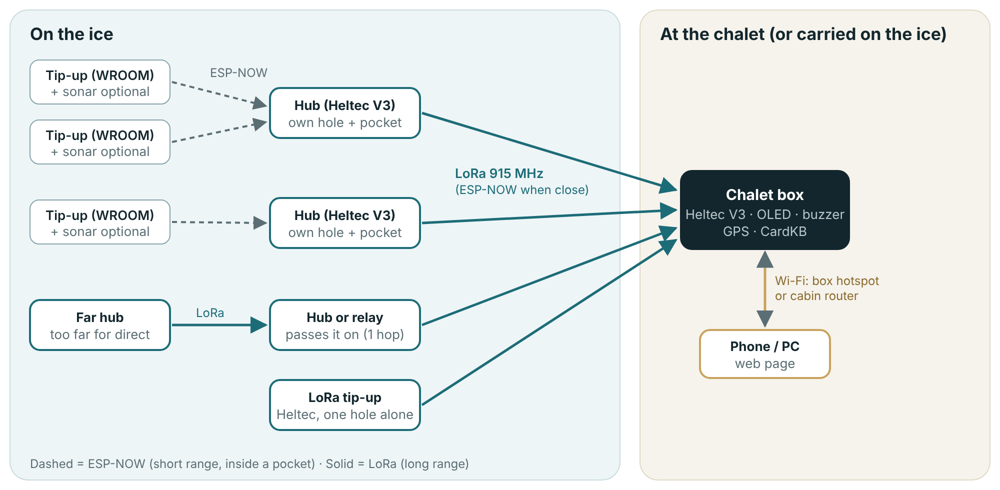

| Role | Board | Flash as | Own hole | Sonar |
|---|---|---|---|---|
| Chalet | Heltec V3 | `chalet` | no | no (shows the others) |
| Hub | Heltec V3 | `hub` | yes | optional (`--sonar`) |
| LoRa tip-up | Heltec V3 | `sensor_lora` | yes | optional (`--sonar`) |
| Relay | Heltec V3 | `relay` | no | no |
| Tip-up | ESP32 WROOM | `tipup_wroom` | yes | optional (`--sonar`) |
| Tip-up (v1 head) | ESP32-C3 | `tipup_c3` | yes (reed) | no |

Hub or LoRa tip-up? Same board, same wiring. WROOM tip-ups around it = hub. Alone = LoRa tip-up.

### 2.1 Tip-up pod (3D model)

Printed pod on a Berkley tip-up: battery box with the sonar shield, mast with the board head about 20 cm above the
ice, sliding arm with the Hall sensor, magnet clamp on the shaft. Model v3.0.1, will change.

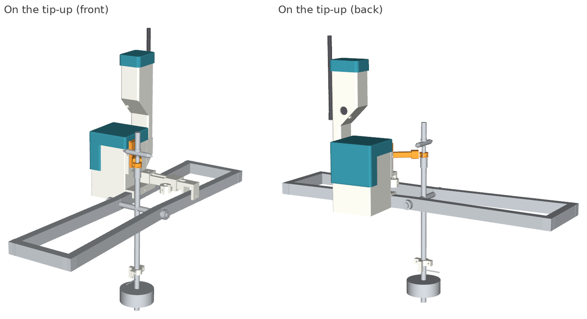

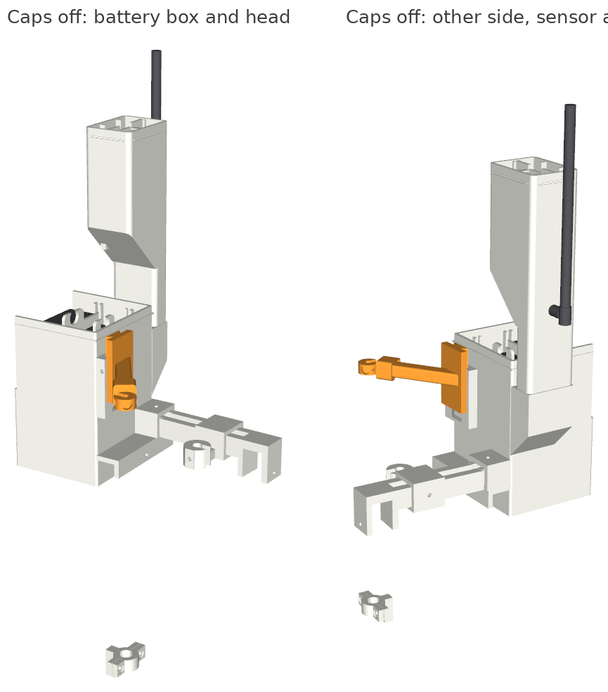

## 3. Material

### 3.1 Chalet box

| Qty | Item | Note |
|---|---|---|
| 1 | Heltec WiFi LoRa 32 V3 + 915 MHz antenna | OLED is on the board |
| 1 | Active buzzer (CLT1036 or similar) | GPIO7. Passive works too: Settings → Buzzer type |
| 1 | M5Stack CardKB | I2C on GPIO41 (SDA) / GPIO42 (SCL). Optional but needed for the menu and GPS pinning |
| 1 | GPS module, GT-U7 / NEO-6M class | Optional. See 4.4.4 |
| 1 | Small transistor (low-side switch for the GPS GND) | Optional: GPS GND can go straight to GND |
| 1 | 1S LiPo on the Heltec JST, or USB power | Charges from USB-C |

### 3.2 Hub or LoRa tip-up

| Qty | Item | Note |
|---|---|---|
| 1 | Heltec WiFi LoRa 32 V3 + 915 MHz antenna | |
| 1 | 3 × AA Energizer L91 pack with switch | |
| 1 | TPS63020 buck-boost, set to 3.3 V | Feeds the Heltec 3V3 pin |
| 1 | US1881 Hall latch + 4 × N52 magnets | Magnets in the shaft clamp at 45/135/225/315°, poles alternating. Or a reed switch (4.4.5) |
| 1 | 12 mm waterproof push button | Arming button, GPIO5 to GND |
| 2 | 100 k resistors (2:1 divider) | Pack voltage to GPIO2 |
| | Sonar add-on (3.4) | Optional |

### 3.3 WROOM tip-up

| Qty | Item | Note |
|---|---|---|
| 1 | ESP32 WROOM DevKit V1, 30-pin | |
| 1 | 3 × AA Energizer L91 pack with switch | |
| 1 | TPS63020 buck-boost, set to 3.3 V | |
| 1 | US1881 Hall latch + 4 × N52 magnets | Same as the hub |
| 1 | 12 mm waterproof push button | GPIO33 to GND |
| 2 | 100 k resistors (2:1 divider) | Pack voltage to GPIO34 |
| | Sonar add-on (3.4) | Optional |

### 3.4 Sonar add-on (per hole)

| Qty | Item | Note |
|---|---|---|
| 1 | Open Echo TUSS4470 shield 002 | |
| 1 | 200 kHz transducer, BBDM-40200K-DA | 14° beam |
| 1 | MT3608 boost, set to 21.5 V | Into J4 middle pin |

### 3.5 Software

| Item | Note |
|---|---|
| VS Code + PlatformIO extension (or `pio` CLI) | Builds and uploads |
| Python 3 | `tools/flash.py` |
| USB-C cable (Heltec), micro-USB (DevKit) | |
| Serial monitor at 115200 | Included in PlatformIO |

## 4. Installation

### 4.1 Get the code

```
git clone https://github.com/frosted123456/Fishing_system_v2
cd Fishing_system_v2
git checkout v2/phase1-mesh-core
```

### 4.2 Cabin Wi-Fi (optional, chalet only)

Copy `src/lora_node/secrets.example.h` to `src/lora_node/secrets.h` and fill in the network name and password.
`secrets.h` is never committed.

Skip it and the chalet runs on its own hotspot. You can also set the Wi-Fi later:

- OLED: Settings → Wi-Fi → Choose network (CardKB)
- Serial: `WIFI:name:password`

### 4.3 Flash a board

1. Plug the board in USB.
2. Open `tools/flash.html` in a browser, pick the board and its job. It gives the command.
3. Run it. Example:

```
python tools/flash.py chalet --id 100 --name "Chalet" --port COM7 --monitor
python tools/flash.py hub --id 1 --name "Pointe" --sonar --port COM8
python tools/flash.py tipup_wroom --id 11 --name "Baie" --sonar --port COM9
```

| Option | Use |
|---|---|
| `--id N` | 1-100, unique on the network |
| `--name "..."` | Name shown everywhere (can be changed later on the page) |
| `--sonar` | Board has the TUSS4470 shield (`tipup_wroom`, `hub`, `sensor_lora`) |
| `--bench` | Bucket test build: sonar runs from boot, `BENCH` line every 2 s (`tipup_wroom`, `hub`). Includes `--sonar` |
| `--build-only` | Build, no upload |
| `--port` | COM port. Leave out and PlatformIO guesses |
| `--monitor` | Open the serial monitor after the upload |
| `--env <name>` | Re-flash a board already in `devices.ini` |

Each board is saved in `devices.ini`. To re-flash the same board: `python tools/flash.py --env hub1_sonar --port COM8`.

ID suggestion: chalet 100, hubs 1-9, tip-ups 11, 12 (pocket 1), 21, 22 (pocket 2)..., relays 90+. A hub's own hole uses the hub's ID.

> **Flash order after a firmware update: every hub and LoRa tip-up first, the chalet last.**

### 4.4 Wiring

#### 4.4.1 WROOM tip-up + shield 002


| # | ESP32 DevKit V1 | Shield 002 | Signal |
|---|---|---|---|
| 1 | **3V3** (TPS63020 3.3 V) | **5V** pin | TUSS4470 VDD. **Never 5 V.** |
| 2 | GND | GND | Common ground (pack, TPS63020, MT3608, ESP32, shield) |
| 3 | D18 | D13 | SCLK |
| 4 | D19 | D12 | SDO → MISO |
| 5 | D23 | D11 | MOSI → SDI |
| 6 | D5 | D10 | NCS |
| 7 | D26 | D8 | IO1 |
| 8 | D25 | D9 | IO2 (burst) |
| 9 | VP (GPIO36) | A0 | VOUT echo. Twist with its own GND wire |
| 10 | - | **J4 middle pin**, no jumper on J4 | MT3608 output + (MT3608 GND to shield GND) |
| - | not wired | D2, D3, RESET, AREF, 3.3V, VIN | |

Other WROOM connections:

| Pin | To |
|---|---|
| GPIO27 | Hall latch OUT. US1881 VDD from the **pack**, not 3.3 V |
| GPIO33 | Arming button to GND (no resistor) |
| GPIO34 | 2:1 divider from the pack |
| GPIO2 | LED (on the DevKit) |

#### 4.4.2 Heltec V3 + shield 002 (hub, LoRa tip-up)


| # | Heltec V3 | Shield 002 | Signal |
|---|---|---|---|
| 1 | **3.3V** pin | **5V** pin | TUSS4470 VDD. **Never 5 V.** |
| 2 | GND | GND | Common ground |
| 3 | GPIO47 | D13 | SCLK |
| 4 | GPIO33 | D12 | SDO → MISO |
| 5 | GPIO48 | D11 | MOSI → SDI |
| 6 | GPIO34 | D10 | NCS |
| 7 | GPIO38 | D8 | IO1 |
| 8 | GPIO39 | D9 | IO2 (burst) |
| 9 | GPIO6 | A0 | VOUT echo. Twist with its own GND wire |
| 10 | - | **J4 middle pin**, no jumper on J4 | MT3608 output + at 21.5 V, MT3608 input from the pack |
| - | not wired | D2, D3, RESET, AREF, 3.3V, VIN | |

Other Heltec connections:

| Pin | To |
|---|---|
| 3.3V pin | TPS63020 3.3 V output |
| GPIO4 | Hall latch OUT (or reed, 4.4.5). US1881 VDD from the pack |
| GPIO5 | Arming button to GND |
| GPIO2 | 2:1 divider from the pack (not the onboard VBAT pin) |
| GPIO7 | Buzzer (optional on a hub) |

Turn the pack off when USB is plugged in.

#### 4.4.3 Shield 002 set-up

- Frequency jumpers: **JP3 + JP4 only** (200 kHz). JP1, JP2, JP5, JP6 open.
- Transducer: cable shield → **top** pin, signal → bottom pin.
- MT3608 into the **J4 middle pin** only. Not VIN, not the XT30.
- MT3608 at **21.5 V** (max ~22 V).
- Optional: remove R3 (power LED).

#### 4.4.4 Chalet box (offshore module)

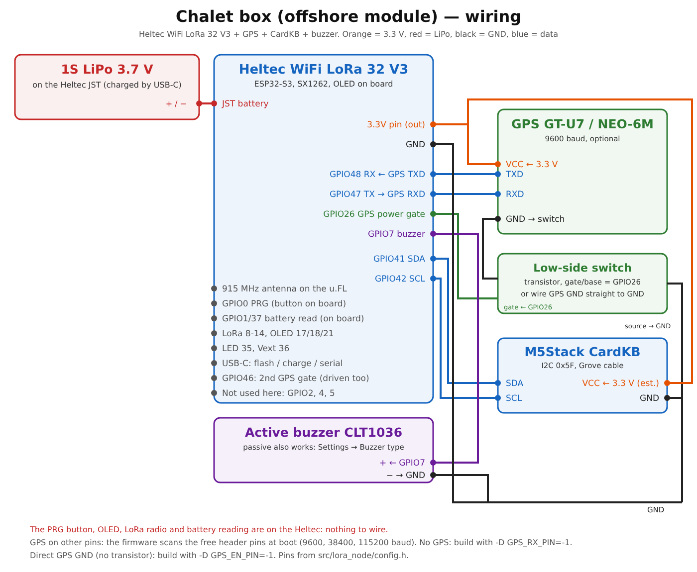

| # | Heltec V3 | To | Signal |
|---|---|---|---|
| 1 | JST battery | 1S LiPo 3.7 V | Power. Charges from USB-C |
| 2 | 3.3V pin | GPS VCC, CardKB VCC | 3.3 V out |
| 3 | GND | GPS switch, CardKB GND, buzzer − | Common ground |
| 4 | GPIO48 | GPS TXD | GPS → Heltec (9600 baud) |
| 5 | GPIO47 | GPS RXD | Heltec → GPS |
| 6 | GPIO26 | Transistor gate/base | GPS power on (driven high). GPIO46 is driven too |
| 7 | GPIO41 | CardKB SDA | I2C |
| 8 | GPIO42 | CardKB SCL | I2C |
| 9 | GPIO7 | Buzzer + | Active buzzer (CLT1036) |
| - | GPIO2, 4, 5 | not wired | Hole sensor, button and divider are for hubs only |

On the board, nothing to wire: PRG button (GPIO0), OLED, LoRa radio, battery reading (GPIO1/37), LED.

- CardKB VCC on 3.3 V is est.: check your box (the CardKB also takes 5 V).
- GPS GND straight to GND (no transistor): build with `-D GPS_EN_PIN=-1`.
- No GPS: build with `-D GPS_RX_PIN=-1`.
- GPS on other pins: the chalet scans the free header pins at boot and keeps the one that answers.

#### 4.4.5 Reed switch instead of the Hall sensor

A reed switch can replace the Hall latch to detect FISH ON. The code is still active (the C3 tip-up uses it).

| Board | Wire | Build flag (add to the board in `devices.ini`) | Polarity |
|---|---|---|---|
| Heltec hub / LoRa tip-up | Reed between GPIO4 and GND | `-D HOLE_HALL_LATCH=0` | OLED Settings → Reed polarity |
| WROOM tip-up | Reed between GPIO27 and GND | `-D HALL_LATCH=0` | `REED_ACTIVE_HIGH` in `src/sensor_node/config.h` |
| C3 tip-up | Reed between GPIO4 and GND | none (reed by default) | `REED_ACTIVE_HIGH` |

Default polarity: trips when the pin goes HIGH (contact opens). With a reed, the trip follows the switch level, not
spool turns.

### 4.5 Bench check

| Step | Do | Expect |
|---|---|---|
| 1 | Power the chalet alone | Boot screen, then Home |
| 2 | Power a hub | Chalet Home shows the pocket within a few seconds |
| 3 | Power a tip-up | 2 quick blinks at boot. It starts armed |
| 4 | Turn the spool a quarter turn | FISH ON on the chalet, buzzer, phone |
| 5 | Web page → Settings → Advanced → Wiring check → Run | Sensor, button, battery, sonar shield, radio OK. A sleeping tip-up answers within 1 min |
| 6 | Sonar holes: flash with `--bench`, transducer in a bucket | `BENCH` line every 2 s on serial, bottom found |

## 5. Setting up on the ice

1. Mount every board **at least 20 cm above the ice**.
2. Turn on the devices in any order as you set the holes. The chalet shows "SETUP" until a hub has been in for
   5 min (10 min max after boot). That is normal.
3. Check every hole is armed (no DISARMED on the page or OLED). Holes keep their armed state across reboots.
4. Connect the phone (6.3).
5. Place the holes on the map:
   - With GPS: carry the chalet box to each hole, OLED → GPS / pin holes, select the hole, Enter.
     Or on the page: tap the hole → **Pin here**.
   - Without GPS: on the page, tap the hole → **Tap the map**.
6. Set the bait depth of each sonar hole: tap the hole → bait.
7. Check bait: disarm the hole first (short press), re-arm after.

The first time, the map origin is set by itself once the chalet GPS is steady for 30 s. It is kept after that.
To move it: OLED GPS page → Chalet here, or tap the chalet on the map → **Chalet here**. Pinning a hole needs a GPS
fix and an origin.

## 6. Functions

### 6.1 Tip-up

| Action | Result | LED |
|---|---|---|
| Short press | Arm / disarm | Armed: 2 short. Disarmed: 1 long |
| Short press while tripped | Clear the trip | 1 short |
| Hold 3 s | Send a status report now | 3 short |
| Spool turns a quarter turn | FISH ON | |
| Spool still for 30 s | Line back to normal on the tip-up | |

A disarmed hole ignores the spool (use it to check the bait). Disarming a tripped hole also clears the alarm on
the chalet. Clearing a trip at the hole does not: the chalet keeps ringing until silenced.

Holes start armed and keep their state across reboots. The hub and LoRa tip-up button (GPIO5) works the same,
with the white LED and a short chirp. LED also blinks once per status sent and 3 times per alert sent.

### 6.2 Chalet box and hubs (OLED)

**PRG button**

| Press | Chalet | Hub |
|---|---|---|
| Short | Next page. During FISH ON: silence. Screen asleep: wake it | Same |
| Double | Page action (written at the bottom). On Home: unsilence | Same |
| Hold 3 s | Connect phone page | Hotspot on/off (30 min, +5 min while a phone is on it) |
| Hold 10 s | Network reset (link, channel and relays back to default; names, alerts and Wi-Fi kept) | Same |

A bar shows what releasing will do (from 1 s). Pages go back to Home after 60 s (Settings 3 min). The screen
sleeps after 5 min and wakes on FISH ON or any press. GPS pinning and Wi-Fi options need the CardKB.

**CardKB (chalet)**

| Key | Does |
|---|---|
| Esc | Menu. In a page: back to the menu |
| ← / → | Previous / next page |
| ↑ / ↓ | Inside the page (more holes, next hole, list) |
| Enter | Page action ("OK: ..." at the bottom) |
| Space / Tab / n, p | Next / previous page |
| + / − / a | Sonar and Focus: depth scale (a = auto) |
| S | Silence on/off |
| Any key during FISH ON | Silence |
| Del, twice | GPS page: clear the selected hole's position |

**Pages**

| | |
|---|---|
| 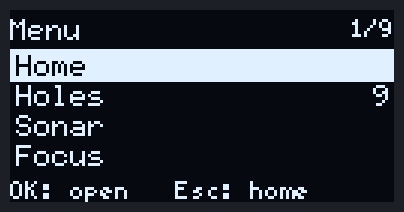 | **Menu** (Esc). All pages. |
| 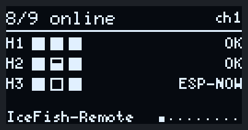 | **Home**. Holes online, one row per pocket (filled = OK, hollow = offline, half = low battery, X = sensor fault, blinking = FISH ON). Link per pocket: OK (LoRa), ESP-NOW, n off, LOST. Footer: near bait, battery low, range test. |
| 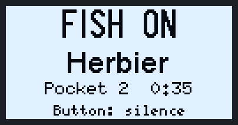 | **FISH ON**. Takes over every page, blinks until silenced. |
| 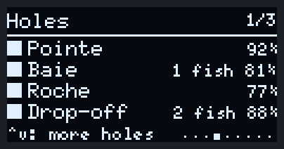 | **Holes**. 4 per page: name, fish seen by the sonar, battery. ↑ / ↓ for more. |
| 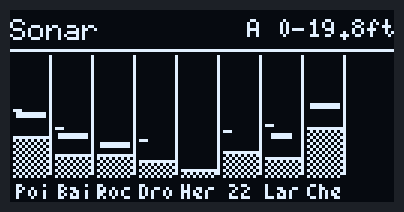 | **Sonar**. One column per sonar hole: bottom, fish (bars), bait (tick). |
| 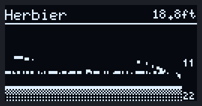 | **Focus**. Fish finder of the watched hole, last ~30 s. ↑ / ↓ = other hole. |
| 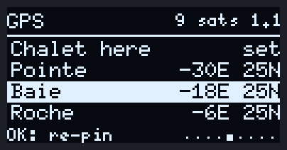 | **GPS / pin holes**. Chalet here = map origin. Select a hole, Enter = pin it where the box is. |
| 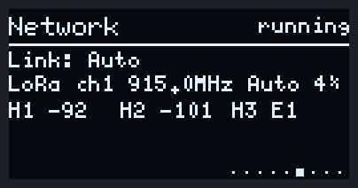 | **Network**. Link, LoRa channel and activity, signal of each hub (E = via ESP-NOW). |
| | **Test / simulation**. Holes running fake sonar or fake trips, radio test. |
| 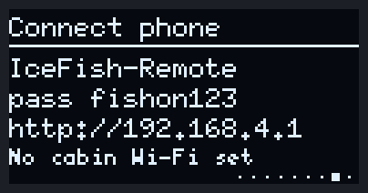 | **Connect phone**. Wi-Fi name, password and address. |
| 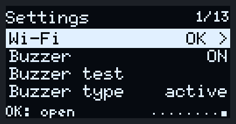 | **Settings**. Wi-Fi, buzzer, near-bait beep, alarm, LoRa channel, simulation, sonar filter, display, network reset, reboot. |
| 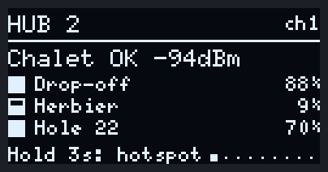 | **Hub Home**. Link to the chalet, its holes and battery. Hub pages: Home, Holes, Network, Connect, Settings (hotspot, buzzer, alarm, ESP-NOW relay, reed polarity, network reset, reboot). |
| 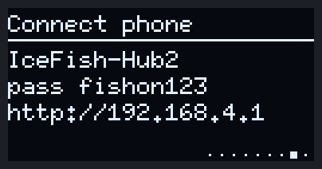 | **Hub Connect**. Hold PRG 3 s to turn the hub hotspot on. |

### 6.3 Web page

**Connect**

| Where | Wi-Fi | Address |
|---|---|---|
| Chalet hotspot | `IceFish-Remote`, password `fishon123` | http://192.168.4.1 |
| Cabin Wi-Fi (secrets.h or Settings → Wi-Fi) | Same network as the chalet | The address on the OLED Connect page, or http://icefish.local |
| Hub hotspot (hold PRG 3 s) | `IceFish-Hub<N>`, password `fishon123` | http://192.168.4.1 |

`icefish.local` works on most PCs and iPhones. Some Android phones need the number address.

Works in a phone or PC browser. Tap once on the page to allow the alert sound.

On every tab: status line, **Sound on/off**, **Silence alerts**, and a red FISH ON bar at the bottom with the hole names.

**Holes tab**

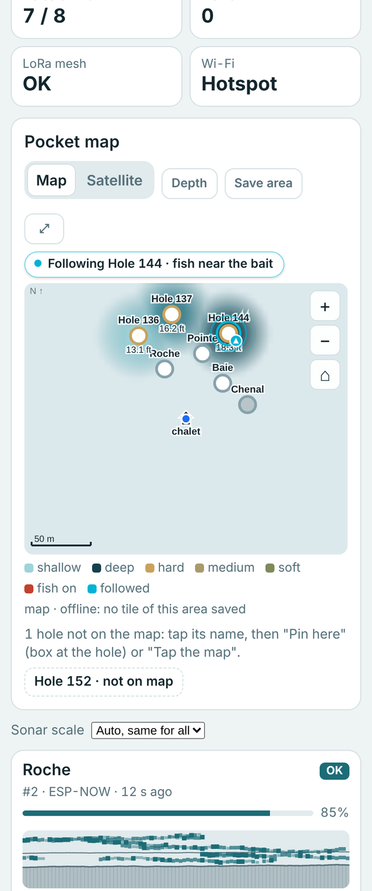

| Item | Does |
|---|---|
| Pocket map | Drag to pan, pinch or +/− to zoom, ⌂ = back to the chalet, ⤢ = full screen |
| Map / Satellite | Background (needs internet on the phone, or a saved area) |
| Depth | CHS bathymetry where it exists |
| Save area | Keeps the tiles of what you see on the chalet, for any phone on the ice |
| Cyan ring | Hole being followed (see Sonar tab). Arrow = it just moved there. Padlock = your pick |
| Tap a hole | Sheet: bottom, fish, bait, line out, battery, link, distance. Arm / Disarm, bait, Watch sonar, Pin here, Move, Remove |
| Tap the chalet | Chalet here, clear all positions |
| Live card | Beside the map: the whole water column of every streaming hole, newest on the right. Bottom, fish, bait line. Follow the action button and the 1 / 2 / 3 picker: how many holes stream at once (more = more radio, slower page). Tap a panel for the full view on the Sonar tab |
| Hole cards | Folded under the Live card. State, battery, link, last minutes of sonar. Watch, Set bait, Arm / Disarm, Rename |

**Sonar tab**

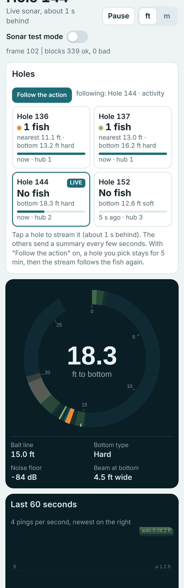

| Item | Does |
|---|---|
| Follow the action | On by default. The live view goes to the hole with the most action. FISH ON wins for 2 min. Up to 2 more holes stream at the same time when the radio has room ("LIVE too") |
| Hole cards on top | Every sonar hole with its water-column preview. Tap one to watch it live; your pick stays 5 min, then Follow takes over again |
| Flasher | Live, about 1 s behind. Pause to freeze |
| Last 60 seconds | Waterfall, 4 pings per second |
| ft / m | Depth units on this phone |
| Display | Depth scale, colour gain, weak echoes |
| Processing | Noise filter, water type (lake / shallow / bucket), Advanced, Defaults, Send to holes again |
| Sonar test mode | Fake sonar on the test holes |

**Radio tab**

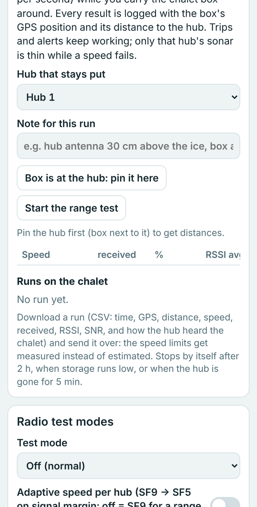

| Item | Does |
|---|---|
| Links | When the chalet last heard each hub on LoRa and ESP-NOW |
| Range test | See section 7 |
| Radio test modes | Fixed or rotating speed for every hub, adaptive speed (on by default), reset stats |
| Hubs | Speed (SF) used per hub, packets, signal |

**Settings tab**

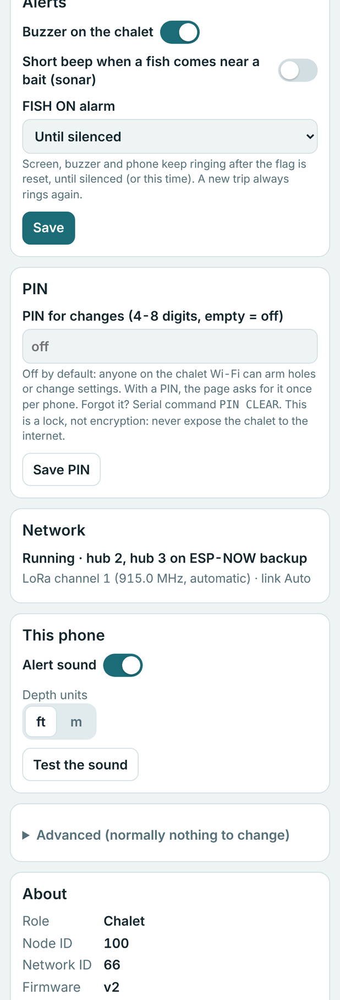

| Section | Contains |
|---|---|
| Alerts | Chalet buzzer, near-bait beep, FISH ON alarm: until silenced, or 1, 5, 15, 30 min after the trip |
| PIN | Optional 4-8 digit PIN for any change from the page. Silence and Watch never need it |
| Network | Wi-Fi state, link, channel |
| This phone | Alert sound, depth units, sound test |
| Advanced | Line per spool turn, beam angle, wiring check, map storage, LoRa channel, relays, test and simulation |
| About | Version |

Forgot the PIN: serial `PIN CLEAR`.

### 6.4 Alerts

| Event | Chalet | Phone |
|---|---|---|
| FISH ON | Screen, buzzer | FISH ON bar, beep |
| Silence (button, key or page) | Sound stops. Holes already back to normal are cleared. A hole still out rings again after 5 min | Same on every phone |
| Line back to normal | Keeps ringing until silenced (default) or the alarm time in Settings | |
| New trip | Always rings, even during a silence | |

### 6.5 Map offline

At home with internet: open the Holes tab, move to the lake, zoom in, **Save area**. The tiles stay on the chalet
(up to ~4.8 MB, shared with the depth pack and range test runs). Tiles seen on a phone also stay on that phone.

Depth contours (optional, PC):

```
pip install numpy rasterio matplotlib pyproj
python tools/lake_prep.py --bbox 45.40 -75.80 45.55 -75.60 --nonna --name "Ottawa-Gatineau" --out season.json
```

Then Settings → Advanced → Map storage → Store on chalet.

## 7. Range test

LoRa only. Gives the success rate of each speed (SF9 to SF5) against distance. SF6 and SF5 need the hub on
firmware D80; older hubs test SF9 to SF7 only.

1. Put the chalet box next to the hub that stays put. It must reach the chalet directly and not relay another hub.
2. Web page → Radio → Range test. Pick the hub.
3. Press **Box is at the hub: pin it here** (needs a GPS fix and the map origin set).
4. Add a note if you want (ice, antenna height...). Press **Start the range test**.
5. Walk away with the box. The banner shows the run on every tab, and the OLED Home footer shows `RANGE <distance> SF<n> ok/--`.
6. Press **Stop**, then **Download CSV**.

The run stops by itself after 2 h, if the hub is not heard for 5 min, or if storage is low. 30 runs max: download
and delete old ones. The other hubs keep working during the test.

During a run the hub-to-chalet link is forced to LoRa (the Radio tab shows it), then goes back to the setting at
stop. Without that, a hub next to the chalet talks ESP-NOW, keeps its LoRa radio idle, and every row reads `ok 0`.
A side-by-side check should show `ok 1` on all five speeds with an RSSI around -20 to -40 dBm within a minute of
starting (the hub needs a few seconds to switch over).

CSV columns: `t_s, utc, lat, lon, sats, hdop, dist_m, frame, mode, ok, crc, rssi_dbm, snr_db, hub_beacon_rssi, hub_beacon_snr, hub_beacon_lost64`.

## 8. How the LoRa airtime is shared

One LoRa channel, one frame of 0.5 s (it stretches to 1, 1.5 or 2 s by itself when the turns don't fit). The chalet
sends a beacon at the start of each frame with the turn of every hub: when, how long, how many bytes, at what
speed. Hubs only transmit in their turn. WROOM tip-ups use ESP-NOW
to their hub, which costs no LoRa time: the hub packs its whole pocket into its own turn.

| Part of the frame | What it is |
|---|---|
| beacon | Chalet → everyone. The plan for this frame, the watched hole, commands |
| echo | A hub repeats the beacon for the hubs the chalet can't reach |
| join | Free slot for a hub that just switched on |
| hub turns | One per hub, sized by the bytes it may send (96 B normal, 180 B per streamed hole, up to a full 255 B packet when there is room) and its speed. A hub streaming several holes can get two turns |
| free | Left over. The chalet uses it to give bigger turns, or shortens the frame later |

Speed: every hub starts at SF9 (slow, long range). When its signal has margin, the chalet steps it up to SF8, SF7,
SF6, SF5. Each step roughly halves the time of its turn. A hub that misses packets is stepped back down. A hub
behind another hub (one hop) costs twice: its turn, then again inside the relay's turn.

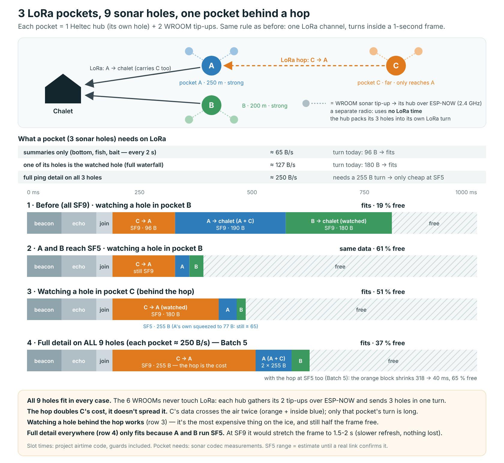

Follow the action streams up to 3 holes at once when the room is there (the extra ones show "LIVE too" on the Sonar
tab); they are the first thing dropped when the frame gets tight. If the turns still don't fit, the frame stretches.
Nothing is lost, updates are slower.

## 9. Troubleshooting

| You see | Do |
|---|---|
| Hole offline | Check its power. Raise it. Move it closer to its hub |
| Whole pocket offline | Check the hub power and antenna. Add a hub or relay halfway |
| "SETUP" on the chalet | Normal until a hub has been in for 5 min (10 min max after boot) |
| Pocket "ESP-NOW" on Home | Normal: that hub is close and talks ESP-NOW. LoRa takes over when ESP-NOW is lost |
| Pocket "LOST" on Home | Neither link. Check the hub power, antenna and distance |
| Phone can't find the page | Hotspot: join `IceFish-Remote`, open http://192.168.4.1. Cabin Wi-Fi: use the address on the OLED Connect page |
| Cabin Wi-Fi "not found" | Wrong name, or the router is too far. The chalet retries every 60 s |
| No sound on the phone | Tap the page once. Check Sound on. Check the phone is not on silent |
| Map is grey | No internet and no saved area. Set the chalet origin (GPS) first |
| No distances in the range test | GPS fix, map origin set, hub pinned (step 3) |
| FISH ON bar missing a hole | Offline holes are not shown in the bar; the chalet still rings |
| Hub stuck at SF7 | It still runs firmware older than D80. Re-flash it |
| Wiring check fails on the sonar | Shield 5V pin on 3.3 V? MT3608 at 21.5 V into J4? JP3 + JP4 on? |
| Forgot the PIN | Serial `PIN CLEAR` |
| Everything acts weird | Hold PRG 10 s on the chalet (network reset) |

## 10. Serial commands

115200 baud. Type in capitals. Chalet unless noted.

| Command | Does |
|---|---|
| `WIFI:name:password` | Save the cabin Wi-Fi and restart |
| `WIFI?` | Wi-Fi state |
| `WIFI CLEAR` | Forget the cabin Wi-Fi (the one in secrets.h comes back at the next boot) |
| `PIN CLEAR` | Remove the web PIN |
| `GPS` / `GPS SCAN` | GPS state / look for the GPS on the free pins again |
| `RADIO` | Radio and network state |
| `TRANSPORT EBFIRST\|LORA\|ESPNOW` | Hub ↔ chalet link (EBFIRST = default: ESP-NOW when close, LoRa otherwise) |
| `CHANNEL AUTO\|1-8\|SCAN` | LoRa channel |
| `RELAY <id> ON\|OFF` | ESP-NOW relay on a hub or tip-up. `RELAY ON\|OFF` on any board = that board |
| `TEST OFF\|ROTATE\|SF9\|SF8\|SF7` | Radio test mode |
| `ADAPT ON\|OFF` | Adaptive speed |
| `NETRESET` | Network reset (same as PRG 10 s) |
| `BUZZ` / `BUZZ ACTIVE\|PASSIVE` | Test the buzzer / set its type |
| `BAIT <hole> <cm>` | Bait depth of a hole (5 cm steps) |
| `KNOBS` / `KNOB <key> <value>` / `KNOB DEFAULTS` | Sonar processing settings, sent to every sonar hole |
| `DEMO <hubs 1-4> [holes 1-4]` / `DEMO OFF` | Fake network inside the chalet, no other hardware |
| `SIM ALL ON\|OFF` / `SIM <hole> SONAR\|HALL\|BOTH\|OFF` | Fake sonar and fake fish |
| `HOLE` / `HOLE ARM\|DISARM\|CLEAR\|TEST` | Hub or LoRa tip-up: own hole state, arm, disarm, clear, wiring check |
| `HOTSPOT ON\|OFF` | Hub: hotspot |
| `MAP` / `MAP CLEAR` | Depth pack size / remove it (saved tiles stay) |

## 11. Repository layout

```
platformio.ini      build environments, one per role; devices.ini = your boards
src/lora_node/      Heltec firmware: chalet, hub, relay, LoRa tip-up
src/sensor_node/    WROOM / C3 tip-up firmware
include/            messages shared by both
lib/IceMesh/        mesh, sonar codec and processing, alarm rules
lib/SonarTuss/      TUSS4470 driver
web/suite.html      web page (built into the firmware by tools/gen_web.py)
tools/              flash.html, flash.py, gen_web.py, lake_prep.py, web_preview.py
images/             pictures for this README
```

## 12. Credits

The sonar side started from **open_echo** by Jan Neumann: the TUSS4470 shield 002 and the register sequence
that works in water. The firmware here (driver, processing, mesh, web page) is our own, not a fork.

```bibtex
@misc{open_echo,
  author       = {Jan Neumann},
  title        = {open\_echo},
  year         = {2026},
  publisher    = {GitHub},
  journal      = {GitHub Repository},
  howpublished = {\url{https://github.com/Neumi/open_echo}},
  note         = {ORCID: https://orcid.org/0009-0003-9829-8959}
}
```
